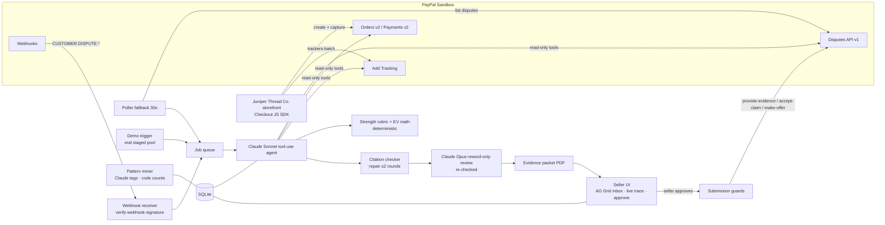

# DisputeDefender

**A chargeback just landed. DisputeDefender drafts a fully sourced response, and the seller decides whether it gets sent.**

DisputeDefender is a dispute agent for small PayPal sellers. A `CUSTOMER.DISPUTE.CREATED` webhook starts a Claude tool-use agent. The agent pulls the dispute, the transaction, the tracking and the buyer's messages from PayPal. It scores the evidence against a published rubric and checks the cost of fighting against the cost of refunding. If fighting is worth it, it drafts a response where **every sentence cites a stored source**. The seller approves once, and only then does anything go to PayPal. A Patterns view looks across disputes for root causes, so the same dispute is less likely to happen again.

**Who it's for:** solo and 1–10 person e-commerce sellers on Etsy, Shopify, eBay and independent stores that take PayPal. They handle disputes themselves, often late at night. There are three avoidable ways to lose a winnable case:

1. They miss the response deadline.
2. They upload the wrong kind of evidence, such as a screenshot where a carrier record is needed.
3. They write an emotional reply that doesn't address the reason code.

Enterprise chargeback tools are priced for larger merchants. DisputeDefender is built for the seller doing this alone.

> 🧪 **Sandbox demo data.** Everything runs against the PayPal sandbox. The store ("Juniper Thread Co."), its products and its buyers are fictional.

---

## Demo

- **Video (under 3 min):** `<YOUTUBE_URL>`
- **Try it yourself:** follow [Setup](#setup). Mock mode needs no credentials; the full loop needs a PayPal sandbox app and an Anthropic key.

The stopwatch in the UI shows **measured** elapsed times only:

- **Draft ready**: from when the trigger was received until the cited draft is ready.
- **Submitted**: from when the trigger was received until PayPal returns 2xx on the approved action. This time includes the seller's approval time, and the label says so.

---

## Features

### The core loop: a PayPal webhook leads to a cited draft, then seller approval, then `provide-evidence`
- **Event-driven trigger.** The app receives `CUSTOMER.DISPUTE.CREATED / UPDATED / RESOLVED` webhooks and checks each one with PayPal's `verify-webhook-signature`, using the original raw JSON body (never re-serialized). Events that fail verification get `400` and are stored as unverified. Events are stored once each by event id, and the receiver returns `200` within about 1 s.
- **Poller fallback.** Every 30 s the server lists disputes updated since the last sync. A dispute that first appears while the server is running, is in `WAITING_FOR_SELLER_RESPONSE` and has no run gets one, so a slow webhook never stalls a new dispute. Disputes already staged when the server boots are left for the demo trigger, and any dispute can be run from its page.
- **Claude tool-use agent.** It uses read-only tools: `get_dispute`, `get_transaction`, `get_tracking`, `get_messages`, `get_policy`, `get_sku`, `score_evidence` and `compute_expected_value`, and finishes with a `submit_analysis` call whose output is validated with zod (a malformed call goes back to the model with the schema errors). Each tool result is stored as a numbered source (`S1…Sn`). The loop is limited to 12 model turns and 90 s of wall-clock time.
- **Live agent trace.** Every step (tool call, result, check, decision) is written to the DB and streamed over Server-Sent Events to the dispute view as it happens.

### No unsupported claims
- **Deterministic citation checker.** Every sentence must cite at least one source from the current run. Every number, date, tracking-like string and quoted phrase in a sentence must appear in the text of one of the sources it cites.
- **Repair, then remove.** A sentence that fails is sent back to the model with the reason, for up to 2 repair rounds. If it still fails, it is removed and shown in the UI under **"removed, unsupported"**.
- **Citation chips and a source drawer.** Click any chip to see the exact tool result behind that sentence.
- **Opus review pass, kept safe.** Claude Opus may only reword sentences. It must keep the same sentence ids and source ids. Its output goes through the citation checker again. If any sentence fails, the Sonnet draft is kept and the trace logs "review discarded".
- **Edits are checked too.** If the seller edits a sentence before approving, the edit goes through the citation check again.

### When to fight and when to concede
- **Evidence strength score (0–100).** This is a deterministic rubric per reason code, not a trained model. Hover over or tap the score to see each item, whether it is present, and its sources:
  - **Item not received (INR):** tracking attached in PayPal (25), carrier shows delivered (30), delivery ZIP matches the order ship-to (20), signature captured (15), shipped before the buyer's claim date (10).
  - **Not as described (SNAD):** listing description matches the delivered SKU (25), policy published before purchase (20), seller responded in under 48 h (15), return offered per policy (20), no prior SNAD on this SKU in 90 days (20).
  - **Unauthorised:** delivered to the PayPal-verified ship-to (35), signature (25), prior non-disputed orders from the same buyer (20), delivery confirmed (20).
- **Expected-value decision.** This is plain arithmetic you can check by hand. The formulas are shown with their values filled in:
  - Fight: `(1 − s)·(A + F) + T`
  - Accept claim: `A + F`, minus `C·0.5` when the item is returned (labeled "half resale value of returned item")
  - Make offer at `o·A` with `o ∈ {0.3, 0.5}`: `o·A + F·0.5` (labeled "assumes buyer accepts the offer")
  - Here `s` is the strength score divided by 100. The UI labels it "strength used as a rough win proxy, not a trained probability". Claude cannot override the score or the recommendation. It only explains them.
- **Concede in one click.** **Accept & refund** (`accept-claim`) or **Make offer** (`make-offer`) sits next to **Approve & Submit**, with the dollar math beside both buttons.

### Evidence packet and submission
- **Evidence PDF** built with `@react-pdf/renderer`. It contains a cover letter, timeline, tracking proof, a message-thread excerpt, the policy clause, and one footnote per citation. The target size is under 500 KB. The PDF preview shows the same bytes that will be submitted.
- **Guarded submission.** Before any call to PayPal, the app re-fetches the dispute and checks four things: the status is `WAITING_FOR_SELLER_RESPONSE`, the current time is before `seller_response_due_date`, the evidence types are allowed for the reason code (one typed map in `evidence-rules.ts`), and the PDF is under 10 MB. Then it sends a multipart `provide-evidence` request.
- **Nothing is auto-submitted.** Every PayPal-mutating call runs only from a route the seller has approved.

### Prevention: Patterns
- **Root-cause mining.** Disputes are grouped by `(sku, reason)` in code. Claude tags each buyer message with themes from a closed list: `sizing`, `color_mismatch`, `fabric_quality`, `late_delivery`, `wrong_item`, `damaged`, `not_recognized`. **Code does the counting**, and every quote is checked as a verbatim substring of its message.
- **Prevention actions.** For example: *"4 of 6 SNAD claims on JT-114 mention sizing. Update the size chart for JT-114."* This example comes from the bundled fixture history, which carries a "Fixture history" badge.

### Seller inbox (AG Grid Community)
- Custom cell renderers: deadline countdown, status pill, strength bar, amount, reason and recommendation.
- Group by reason or SKU, implemented in our own code with full-width group-header rows. Row grouping in AG Grid itself is Enterprise-only.
- Full-width detail rows that expand into the agent trace.
- Quick filter, a pinned totals row ("$ at risk", "due in < 48 h"), and CSV export.
- Styled with the Theming API (`themeQuartz.withParams`). There are no AG Grid CSS imports and no Enterprise modules.

### Product polish and observability
- Designed empty, loading, error and resolved states, plus a mobile-readable approval flow.
- **Activity page.** Every PayPal call is listed with method, path, status, duration and `paypal-debug-id`.
- **Sandbox controls.** These wrap the sandbox-only `require-evidence` and `adjudicate` endpoints so a dispute can be resolved on camera. They are disabled outside the sandbox.
- **Honest demo trigger.** It takes a **real staged sandbox dispute** from a pool and labels the event *"Demo trigger (not a PayPal webhook)"*. If the pool is empty it returns `409` with restocking instructions. It never fakes a dispute. It is rate-limited per IP and globally.

---

## Architecture



The full component breakdown, schema and API contract are in [`ARCHITECTURE.md`](ARCHITECTURE.md).

---

## Tech stack

| Layer | Technology |
|---|---|
| Payments platform | **PayPal Disputes API v1** (list/show, provide-evidence multipart, accept-claim, make-offer, send-message, sandbox-only require-evidence and adjudicate), **PayPal Webhooks** with `verify-webhook-signature`, **Orders v2 + Payments v2 captures**, **Checkout JS SDK** (`@paypal/react-paypal-js`), **Add Tracking API** (`/v1/shipping/trackers-batch`) |
| AI | **Claude** through `@anthropic-ai/sdk`: **Claude Sonnet** for the agent loop and pattern tagging, **Claude Opus** for the reword-only review pass. Uses tool use with zod-validated outputs; no sampling parameters (current models reject them) |
| App | **Next.js 15** (App Router, route handlers, `instrumentation.ts`), **React 19**, **Tailwind CSS v4**, Server-Sent Events |
| Grid | **AG Grid Community** v34 (`ag-grid-community`, `ag-grid-react`) |
| PDF | **@react-pdf/renderer** |
| Data | **SQLite** via `better-sqlite3` (WAL mode), `zod`, `nanoid`, `date-fns` |
| Hosting (optional) | **Render** web service through the included `render.yaml` blueprint |
| API tooling | **Postman** collection and sandbox environment in `postman/` |
| Quality | TypeScript, ESLint, Vitest, Playwright, gitleaks pre-commit |

Runtime: **Node.js 22.20.0** (`.nvmrc`), npm 10.x, with `package-lock.json` committed.

---

## Setup

### Quick look without credentials (mock mode)

To see the whole loop without a PayPal sandbox app or an Anthropic key:

```bash
npm ci
PAYPAL_MOCK=1 ANTHROPIC_MOCK=1 npm run setup
PAYPAL_MOCK=1 ANTHROPIC_MOCK=1 npm run dev
```

PayPal calls are answered from `data/fixtures/mock-paypal`, and the agent is a **scripted stand-in**, not Claude: it calls the real tools in a fixed order and fills a template from the stored sources. The UI shows a red **MOCK MODE** banner the whole time. Use it to explore the screens; the real agent needs the credentials below.

### Prerequisites

- Node.js **22.20.0** (`nvm use`)
- A free **PayPal Developer** account with a sandbox **REST app** (client id and secret), a sandbox **business** account (seller) and a sandbox **personal** account (buyer)
- An **Anthropic API key**
- For local webhooks, **ngrok** or any other public HTTPS tunnel

### 1. Install

```bash
git clone https://github.com/ROROK20/dispute-defender.git dispute-defender
cd dispute-defender
nvm use
npm ci
```

### 2. Configure environment

```bash
cp .env.example .env
```

| Variable | Purpose |
|---|---|
| `PAYPAL_ENV` | `sandbox` (required for the simulate endpoints) |
| `PAYPAL_CLIENT_ID` / `PAYPAL_CLIENT_SECRET` | Sandbox REST app credentials |
| `PAYPAL_WEBHOOK_ID` | Printed by `npm run webhook:register` (step 4) |
| `NEXT_PUBLIC_PAYPAL_CLIENT_ID` | Same client id, used by storefront Checkout buttons |
| `ANTHROPIC_API_KEY` | Your Anthropic key |
| `ANTHROPIC_MODEL_AGENT` | Agent-loop model (default in `.env.example`: `claude-sonnet-5-5`) |
| `ANTHROPIC_MODEL_REVIEW` | Review-pass model (default in `.env.example`: `claude-opus-5-5`) |
| `REVIEW_ENABLED` | `true` to run the Opus review pass |
| `DATABASE_PATH` | `./data/app.db` |
| `PUBLIC_BASE_URL` | Public HTTPS URL of this app (ngrok or Render) |
| `DISPUTE_FEE_USD` | Your own dispute fee. Defaults to `0`; no fee number is hard-coded |
| `SELLER_TIME_COST_USD` | What an hour of your time is worth for EV math (default `15`) |
| `DEMO_TRIGGER_PER_IP_PER_MIN` / `DEMO_TRIGGER_GLOBAL_PER_HOUR` | Demo-trigger rate limits (`.env.example` sets `3` / `30`; the code falls back to `1` / `10` when unset) |
| `POLL_INTERVAL_MS` | Poller interval (`30000`) |
| `PAYPAL_MOCK` / `ANTHROPIC_MOCK` | **Tests and CI only.** `1` uses fixtures and shows a red "MOCK MODE" banner |

Secrets are never committed. gitleaks runs in pre-commit (`.pre-commit-config.yaml`, `.gitleaks.toml`).

### 3. Initialise the database and store

```bash
npm run setup     # applies db/schema.sql, loads SKUs + fixture history, syncs sandbox disputes if credentials exist
npm run dev       # http://localhost:3000
```

Health check: `GET /api/health` returns the PayPal env, mock flags, DB status and whether a webhook id is set.

### 4. Expose a public URL and register the webhook

```bash
ngrok http 3000
# put the https URL in PUBLIC_BASE_URL in .env, then:
npm run webhook:register
# copy the printed id into PAYPAL_WEBHOOK_ID and restart `npm run dev`
```

This registers `CUSTOMER.DISPUTE.CREATED`, `UPDATED` and `RESOLVED` to `${PUBLIC_BASE_URL}/api/webhooks/paypal`.

> **Note:** The PayPal dashboard **webhook simulator** sends fake resource IDs. These fail signature verification and return 404 on `GET dispute`, so they cannot drive the full flow. Use real sandbox disputes. The poller and demo trigger cover slow delivery.

### 5. Create real orders and stage disputes

The PayPal API cannot create disputes; a buyer has to open them. The full runbook is in [`docs/sandbox-staging.md`](docs/sandbox-staging.md). In short:

1. Open `/store` and buy items with the **sandbox buyer's PayPal wallet**. Each capture is a real Orders v2 transaction, and the app attaches tracking through `trackers-batch`.
2. Optionally run `npm run seed -- --tracking` to add tracking to any captured orders that don't have it.
3. Log in to `https://www.sandbox.paypal.com/` as the buyer and open disputes in the **Resolution Center**, one per reason code. Escalate to a claim where needed.
4. In the dispute view, use **Sandbox controls → Require evidence (SELLER_EVIDENCE)** to move the dispute to `WAITING_FOR_SELLER_RESPONSE`.

To check the submission path before involving any AI:

```bash
npm run smoke:evidence -- <disputeId>   # submits data/static-evidence.pdf, prints status + debug_id
```

### 6. Tests

```bash
npm run typecheck
npm run lint
npm test                                      # unit + integration (Vitest)
PAYPAL_MOCK=1 ANTHROPIC_MOCK=1 npm run test:e2e   # Playwright demo loop in mock mode
```

Unit tests cover the citation checker, the strength rubric, the EV math, the evidence rules, the multipart builder, the webhook verify body, pattern counting and the submission guards.

### Deploy to Render

`render.yaml` defines one free-tier Node web service. The build command is `npm ci && npm run build`, the start command is `npm run setup && npm start`, and the health check is `/api/health`. Set secrets in the Render dashboard, then set `PUBLIC_BASE_URL` to the Render URL and run `npm run webhook:register` again.

Free-tier caveats:
- There is no persistent disk, so SQLite is rebuilt on every boot and the poller pulls live sandbox disputes back in.
- Free services sleep after 15 min idle. PayPal retries webhooks, and the poller catches up after the first request.

### Real carrier data (optional)

Tracking for the demo comes from PayPal's Add Tracking API plus a clearly labeled **carrier fixture provider** (`src/lib/carrier/fixture-provider.ts`). To use real carrier data, implement `src/lib/carrier/adapter.ts` against a carrier API such as EasyPost or Shippo in test mode. This is not included and nothing here requires a paid service.

### Postman

Import `postman/DisputeDefender.postman_collection.json` and `postman/DisputeDefender.sandbox.postman_environment.json` to replay every PayPal call the agent makes: OAuth token, list/show dispute, provide-evidence (multipart), accept-claim, make-offer, send-message, require-evidence, adjudicate, trackers-batch, get capture, get order and verify-webhook-signature.

---

## Usage walkthrough

1. **Inbox (`/`).** The AG Grid queue lists every dispute with a deadline countdown, status, amount, reason, strength bar and recommendation. Group by reason or SKU, filter, expand a row to see its agent trace, or export to CSV. The pinned totals row shows the dollars at risk and how many disputes are due in under 48 h.
2. **A dispute arrives.** A buyer opens a dispute in the sandbox, or you click **Trigger demo dispute**. The webhook is verified and stored, and an agent run starts.
3. **Watch the agent (`/disputes/:id`).** The live trace streams each step: fetch the dispute, then the capture and order, then tracking, messages, policy and SKU. Next it classifies the reason, scores the evidence and computes expected value. Last it drafts the response and runs the citation check. The stopwatch shows *draft ready* and *submitted* times as measured.
4. **Review the draft.** Each sentence carries citation chips, and a click opens the source drawer with the exact tool result. Any sentence that could not be grounded is listed under **removed, unsupported**. Hover over the strength score to see its breakdown, and preview the PDF.
5. **Decide.**
   - **Approve & Submit.** Runs the submission guards, then sends multipart `provide-evidence`. The result panel shows the HTTP status and `debug_id`.
   - **Accept & refund** or **Make offer.** Use these when the EV math says conceding costs less. The formula is shown with your numbers filled in.
   - Optionally send the buyer a courteous message through `send-message`.
6. **Resolve (sandbox).** Use **Sandbox controls → Adjudicate** to simulate the outcome and see the resolved state.
7. **Prevent (`/patterns`).** Recompute patterns to see grouped root causes with verbatim buyer quotes and a suggested prevention action.
8. **Audit (`/activity`).** See every PayPal call with its `paypal-debug-id`.
9. **Storefront (`/store`).** The fictional seller's shop, with real sandbox Checkout and published returns, shipping and size-guide policy pages.

---

## AI tools disclosure

| Tool | Where | How |
|---|---|---|
| **Claude Sonnet** (Anthropic Messages API, tool use) | `src/lib/agent/runner.ts`, `src/lib/patterns/mine.ts` | Runs the multi-step agent: calls read-only PayPal-backed tools, classifies the reason code, explains the deterministic score and EV result, and drafts sentences with source ids through the `submit_analysis` tool. Also tags buyer messages with themes from a closed list for pattern mining. |
| **Claude Opus** | `src/lib/agent/review.ts` | Optional reword-only review of the final draft. It cannot add or remove sources, and its output is discarded if it fails the citation check. |

**Development:** almost all of this codebase was written by AI (Claude, through the Claude Code CLI), under our direction. A multi-agent pipeline generated the first version during the hackathon, and the rest was finished in a Claude Code session. The tests and documentation were also written with Claude.

**What the AI does not do:** it does not compute the strength score, the expected value, or the pattern counts. All three are deterministic code. It never calls a PayPal-mutating endpoint; those run only from seller-approved routes.

---

## Limitations (stated plainly)

- The strength score is a **rubric**, not a trained model, and we make no accuracy claims for it.
- The fixture dispute history is fictional. It carries a badge in the UI, and every PayPal-mutating route rejects it with `422`.
- The app has a single seller and no multi-seller auth. It runs in the sandbox only, and moving to production would need live PayPal credentials and review.
- Evidence types allowed per reason code live in `src/lib/paypal/evidence-rules.ts`. They follow PayPal's Disputes API documentation and still need confirming with a live sandbox `provide-evidence` call (`npm run smoke:evidence`). That file is the single place to correct them.

---

## Team and acknowledgements

[FOUNDER TO FILL: the founders' real names and roles and why this team; only facts you can evidence]

## License

[MIT](LICENSE)
