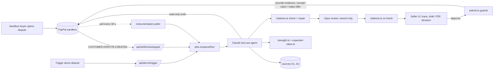

# DisputeDefender architecture (summary)

The full design document is [`ARCHITECTURE.md`](../ARCHITECTURE.md) at the repo root. This page is the short version for judges and contributors.

## Two rules

1. Nothing goes to PayPal without seller approval.
2. No sentence goes into a submission unless it traces to a stored source.

## Flow

## Components

| Component | Where | What it does |
|---|---|---|
| Storefront | `src/app/store`, `src/app/api/store` | Real Orders v2 sandbox checkouts; tracking added on capture |
| PayPal client | `src/lib/paypal` | Token cache, logged fetch (debug_id), typed wrappers, mock adapter |
| Webhook receiver | `src/app/api/webhooks/paypal` | Raw body, signature verification, idempotent insert, 200 fast |
| Poller | `src/instrumentation.ts`, `src/lib/sync.ts` | Picks up disputes the webhook missed |
| Agent | `src/lib/agent` | Tool loop, numbered sources, step trace over SSE |
| Citation checker | `src/lib/agent/citations.ts` | Deterministic grounding check, 2 repair rounds |
| Scoring | `src/lib/scoring` | Rubric score and expected-value arithmetic; the model cannot override them |
| Evidence PDF | `src/lib/pdf` | Cover letter, timeline, footnote per citation |
| Submission | `src/lib/submit.ts` | Re-fetch, status/deadline/evidence-type/size guards, multipart call |
| Pattern miner | `src/lib/patterns` | Claude tags themes, code counts them, quotes checked as substrings |

## Data

SQLite (`better-sqlite3`, WAL). Schema in [`db/schema.sql`](../db/schema.sql). On Render free tier the DB is rebuilt each boot by `npm run setup`, which reloads the store, the fixture history and then pulls live sandbox disputes back in.

## Scripts

| Command | Purpose |
|---|---|
| `npm run setup` | Apply schema, load SKUs and fixture history, one sync pass if credentials exist |
| `npm run seed -- --tracking` | Load SKUs; add fixture tracking numbers to captured sandbox orders that have none |
| `npm run webhook:register` | Register the three dispute events to `${PUBLIC_BASE_URL}/api/webhooks/paypal` |
| `npm run sync` | One dispute sync pass |
| `tsx scripts/make-static-evidence.ts` | Write `data/static-evidence.pdf` |
| `npm run smoke:evidence -- <disputeId>` | Submit the static PDF to a real sandbox dispute |